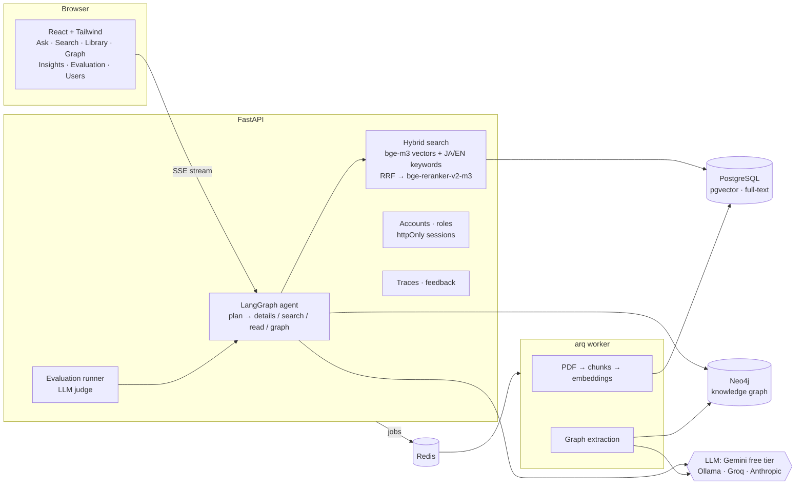

# Shiori: design, results and lessons

Shiori (栞, "bookmark") answers questions about a research library in English or Japanese and
cites the exact page each claim comes from. This document summarizes how it works, what was
measured, and which decisions the measurements changed.

## Architecture

| Layer | Choice | Why |
|---|---|---|
| Embeddings | bge-m3 (local CPU) | one multilingual model: an English question finds a Japanese passage |
| Keyword search | Postgres full-text over EN words + JA bigrams | Japanese has no spaces; no custom Postgres build needed (PGroonga-style bigrams) |
| Fusion | Reciprocal Rank Fusion | merges vector and keyword rankings without comparing score scales |
| Reranker | bge-reranker-v2-m3, bfloat16 on CPU | 2× faster than fp32 at the same scores |
| Agent | LangGraph | one planning call routes each question; no extra cost vs. a rewrite step |
| Graph | Neo4j + LLM extraction | relations across passages; every relation quotes its evidence |
| LLM | any OpenAI-compatible API; Gemini free tier by default | runs at zero cost; Ollama for fully local |

## Results

Measured on three real documents, 108 passages in all: the RAG paper (Lewis et al., 2020), the
DPR paper (Karpukhin et al., 2020), both arXiv PDFs in English, and a
Japanese KAKEN research report on vegetation and landscape management at the Tottori Sand Dunes.

The test set has 29 hand-written questions, each answerable one tied to a verbatim evidence
quote: 23 answerable (English and Japanese, including cross-language, author, compare, "find
all" and summary questions) and 6 the library cannot answer. Answers are graded by an LLM judge
(Gemini 3.5 Flash-Lite); language and citations are checked deterministically.

**Search only (no LLM calls):**

| Configuration | Hit@1 | Hit@3 | Hit@5 | Right passage passed the cutoff | Time |
|---|---|---|---|---|---|
| Keyword only | 22% | 26% | 39% | 43% | 0.02 s |
| Vector only | 30% | 39% | 52% | 57% | 0.15 s |
| Hybrid, no reranker | 26% | 39% | 52% | 57% | 0.16 s |
| Hybrid + reranker, bare passage text | 30% | 39% | 61% | 61% | 5.4 s |
| Hybrid + reranker, 30 candidates, bare text | 35% | 43% | 61% | 65% | 12.5 s |
| Hybrid + reranker, 30 candidates, with headers | 39% | 61% | 74% | 78% | 13.4 s |
| **Hybrid + reranker, 12 candidates, with headers (kept)** | **35%** | **57%** | **74%** | **74%** | **4.9 s** |

These numbers are strict: a hit needs the one passage containing the exact evidence quote, so
"21 million passages" in another passage counts as a miss for a question whose quote is
"21,015,324 passages". Answers, which can use any passage, score much higher:

**Full answers (judged):**

| Configuration | Correct | Faithful | Cited a relevant passage | Unanswerable → "not found" | Right language | Time |
|---|---|---|---|---|---|---|
| Classic single search | 93% | 100% | 70% | 6 / 6 | 100% | 6.4 s |
| Agent, first run | 89% | 96% | 74% | 6 / 6 | 100% | 10.6 s |
| **Agent, after the author fix** | **98%** (93% corrected) | **100%** | **78%** | **6 / 6** | **100%** | **9.1 s** |

The corrected 93% counts one answer the judge wrongly accepted (decision 7). A partial grade
counts as half. With 23 answerable questions, one question is worth about 4
points, so small differences between rows are not meaningful.

## Decisions the measurements changed

1. **Real PDFs broke the parser in ways test PDFs did not.** NUL bytes from math fonts failed
   the database insert; the vertical arXiv stamp was picked as the title; titles wrapped over
   two blocks were cut; section numbers came apart from their titles ("2.1" / "Models"), so
   table values like "37.4%" became headings; two-column pages were read straight across; and
   the "fi" ligature hid "verification" from keyword search. Each now has a regression test.
2. **The reranker needs the heading too.** Embeddings and keywords already included the paper
   title and section, but the reranker judged bare text, so a passage naming its topic only in
   its heading scored low. Adding the header moved hit@5 from 61% to 74%.
3. **More reranker candidates were not worth it.** Going from 12 to 30 costs 2.7 times the
   latency on a CPU for one more question covered (74% → 78%). The pool stays at 12.
4. **The cutoff stays at 0.0003, against the sweep's recommendation.** The sweep prefers 0.1:
   it rejects all 6 unanswerable questions but loses 2 of the 23 answerable ones (74% → 65%).
   The LLM already declined all 6 unanswerable questions at 0.0003, so a stricter cutoff would
   buy nothing and lose real answers.
5. **Language is checked deterministically.** A judge reading an answer in the wrong language
   still grades it correct, so the language metric is computed, and the prompt states the
   reply language for each question. Result on this set: 100%.
6. **Graph extraction must not model the authors.** First-person statements ("We compress the
   document index…") were creating an entity for the writer. The prompt now makes the described
   method the source of the relation and forbids an entity for the authors. On the RAG paper,
   relations went from 38 to 55, and RAG became the best-connected node.
7. **The agent did not beat classic search on correctness.** Its first run scored lower (89%)
   because the details source said "authors not recorded" for arXiv PDFs, which have no author
   metadata; the details now include the first page. After that fix and one judge correction
   the two tie at 93%. The agent cites a relevant passage more often (78% vs 70%) and takes
   about 3 s longer per question.
8. **Judges need checking too.** One answer said "the sources do not state the total area" and
   was graded correct against an expected "about 130 ha". Judge scores are an estimate, which
   is why the deterministic checks exist alongside them.

## Engineering notes

- **Streaming end to end**: answers stream as Server-Sent Events through Caddy
  (`flush_interval -1`); the agent's plan arrives before the first token.
- **Citations you can check**: every claim cites a numbered passage; clicking it opens the PDF
  (pdf.js) at the page with the passage highlighted, matched by overlapping 12-character
  windows so tiny text fragments are not mis-highlighted.
- **Security**: Argon2id passwords; signed sessions in httpOnly, SameSite cookies with a
  session version (password change or deactivation logs out everywhere); login rate limit;
  roles; private conversations; PDF text escaped before rendering; graph queries are fixed
  Cypher templates with parameters.
- **Observability**: every question writes a trace (plan, every passage considered with its
  ranks and scores, cutoff decisions, tokens, cost, per-stage timings, prompt version).
- **Tests**: 147 backend tests (Postgres and Neo4j in CI, fake models so no downloads) and
  frontend unit tests. Neo4j tests run in their own namespace, never touching real data.
- **Resilience**: evaluation runs survive client disconnects; runs cut off by a restart are
  marked failed at the next start.

## Limits and next steps

- The test set is small (three documents, 29 questions, written by the developer after reading
  the papers); add real lab questions before trusting small differences.
- Retrieval is the weak point: only 74% of evidence passages reach the top 5, mostly short
  passages that state one specific fact. Larger libraries will need better recall.
- Reranking costs about 5 s on a laptop CPU.
- Tables and figure labels are extracted as plain text, so numbers in tables lose their
  column meaning. Scanned PDFs need OCR (not implemented); furigana is merged into passages.
- arXiv PDFs have no author metadata, so authors come from the first-page text.
- The graph can keep two names for one thing when a paper uses both.
- Graph extraction can make plausible but unstated links; evidence quotes make them checkable.
- The planner picks one route per question, so a compound question ("who wrote the DPR paper,
  and what does it compare against?") answers only the part that route covers. Splitting compound
  questions into sub-plans is the next agent improvement.

## Deployment check

The production stack (`docker-compose.prod.yml`) was run end to end on a laptop: only the web
server publishes ports; Caddy serves the app with security headers and streams answers; the
backend applies migrations on start; the containerized worker ingested PDFs and
built a knowledge graph; sessions use `HttpOnly; SameSite=lax`
cookies (`Secure` when served over HTTPS). Fixing an over-broad `chown` in the Dockerfile cut
the backend image from 7.05 GB to 4.61 GB.
